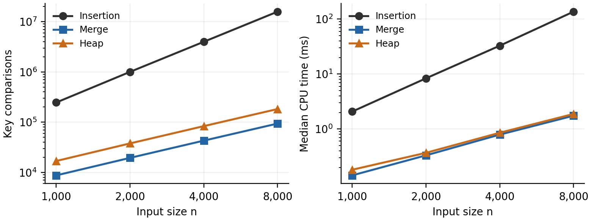

삽입 병합 힙 정렬 비교 보고서

고급알고리즘 과제 1  Compare sorting

이현수  |  첨단융합공학부  |  2026년 9월 30일

학번  ____________________
본인 GitHub 저장소 URL  ______________________________________

## 1 비교 목적과 알고리즘 선정

수업에서 배운 삽입 정렬과 병합 정렬, 배우지 않은 힙 정렬을 C로 구현하고 실행 시간, 비교·이동 횟수, 추가 메모리 및 안정성을 비교하였다. 입력의 크기와 배열 상태를 바꾸어 같은 알고리즘의 성능이 어떤 조건에서 달라지는지 확인하였다.

무작위 원소 4,000개에서 병합 정렬의 실행 시간 중앙값은 0.778ms로, 삽입 정렬보다 약 44.3배 빨랐다. 반면 이미 정렬된 입력에서는 삽입 정렬이 비교 3,999회와 이동 0회로 가장 빨랐다. 힙 정렬은 상수 크기의 작업 버퍼로 처리했지만 중복 키의 순서는 보존하지 않았다.

표 1 구현한 알고리즘의 이론적 특성

| 항목 | 삽입 정렬 | 병합 정렬 | 힙 정렬 |
| --- | --- | --- | --- |
| 핵심 방법 | 정렬된 앞부분에 삽입 | 정렬된 구간 병합 | 최대 힙 구성과 추출 |
| 최선 시간 | O(n) | O(n log n) | O(n)¹ |
| 평균 시간 | O(n²) | O(n log n) | O(n log n) |
| 최악 시간 | O(n²) | O(n log n) | O(n log n) |
| 추가 공간 | O(1) | O(n) | O(1) |
| 안정성 | 안정 | 안정 | 불안정 |
| 구현 방식 | 반복문 | 상향식 반복문 | 반복문 |

¹ 힙 정렬에서 모든 키가 같으면 siftDown이 즉시 종료하여 선형 시간이 가능하다. 서로 다른 키를 정렬하는 일반적인 경우에는 n log n 규모의 비용이 든다. 병합 정렬은 이미 이어 붙일 수 있는 구간을 건너뛰는 최적화를 적용하지 않았다. 평균 복잡도는 일반적인 무작위 입력을 기준으로 비교하였다. [2–5]

교수님 샘플의 공통 인터페이스·삽입 정렬·측정 도구를 활용하고, 병합·힙 정렬과 실험 프로그램 및 테스트를 추가하였다. ChatGPT Codex를 코드 작성, 검증과 보고서 작성에 사용했으며 힙 정렬의 AI 학습 설명은 7절에 첨부하였다. [1]


---

## 2 코드 구조와 실험 방법

### 2 1 공통 인터페이스

세 정렬은 같은 함수 원형을 사용한다. void *와 원소 크기, 비교 함수를 인자로 받아 int 배열뿐 아니라 key와 tag를 가진 구조체도 정렬할 수 있다. 알고리즘 목록에 함수 포인터를 등록하여 측정 코드가 동일한 조건으로 세 함수를 호출하도록 하였다.

```c
void sort(void *base, size_t n, size_t size,
          SortCompare cmp, SortStats *stats);
```

| 파일 | 역할 |
| --- | --- |
| src/sort.h  src/sort.c  src/sortctx.h | 인터페이스와 비교·이동·교환 도구 |
| src/insertionSort.c | 삽입 정렬  샘플 구현 활용 |
| src/mergeSort.c | 보조 배열을 쓰는 상향식 병합 정렬 |
| src/heapSort.c | 반복문으로 수행하는 최대 힙 정렬 |
| src/bench.c  src/main.c | 입력 생성과 반복 측정 및 CSV 출력 |
| tests/test_sort.c | 정렬·원소 보존·안정성·측정 검증 |

### 2 2 측정 조건

실험은 Linux x86_64 컨테이너에서 GCC 13.3.0으로 수행하였다. CPU는 AMD EPYC 9V74로 표시되었으며, 컴파일 옵션은 -std=c17 -Wall -Wextra -Wpedantic -O2이다. 이 보고서의 실행 시간은 위 Linux 환경에서 얻었다.

입력 원소는 Record { int key; int tag; }이며 이 환경에서 8바이트이다. seed는 20260930으로 고정하였다. 무작위 입력은 rand(), 정렬된 입력은 0부터 n−1, 역순 입력은 n부터 1, 중복이 많은 입력은 rand() % 8로 만들었다. 각 입력을 모든 알고리즘에 동일하게 제공하였다.

원소 4,000개에서 입력 상태 네 종류를 비교하고, 무작위 입력에서는 n을 1,000·2,000·4,000·8,000으로 늘렸다. 정렬을 11회 반복하되 매회 원본을 새로 복사한 뒤 clock()으로 측정한 CPU 시간의 중앙값을 보고하였다. 입력 복사와 결과 검증은 시간에서 제외하고, 정렬 내부의 할당·해제와 통계 계수는 포함하였다. CSV에는 평균과 최솟값·최댓값도 기록하였다.

### 2 3 검증과 측정값의 정의

비교는 비교 함수 호출 한 번, 이동은 원소 한 개의 복사 한 번으로 센다. 교환은 임시 공간을 거쳐 복사하므로 이동 3회이다. extraBytes는 정렬이 동적으로 요청한 작업 버퍼 크기이며 입력·측정 도구·스택·할당기 관리 정보는 제외한다. 세 구현 모두 반복문을 사용하므로 재귀가 없다.

make test의 42개 집계 검사가 모두 통과하였다. 기본 배열과 정수 최솟값·최댓값을 검사하고, n=0부터 512까지 원소 보존을 확인하였다. 각 정렬에 대해 길이 0~7의 세 가지 키로 만들 수 있는 배열 3,280개도 모두 검사하였다. ASan·UBSan 검사에서도 오류가 없었다. 실행 환경의 프로세스 접근 제한으로 누수 검사만 비활성화했으므로 메모리 누수 검증 결과로 해석하지 않았다.


---

## 3 정렬 알고리즘의 동작

### 3 1 삽입 정렬

배열의 앞부분을 정렬된 상태로 유지하면서 현재 원소를 적절한 위치에 넣는다. 왼쪽의 더 큰 원소를 한 칸씩 뒤로 이동하고, 확보된 자리에 현재 원소를 기록한다. 이 구현은 바로 앞 원소가 현재 원소 이하이면 삽입 과정을 건너뛴다.

예를 들어 [5, 2, 4, 1]은 [2, 5, 4, 1], [2, 4, 5, 1], [1, 2, 4, 5]로 변한다. 같은 키에서는 > 조건으로 이동을 멈추므로 안정적이다. 정렬된 입력은 비교 n−1회만 필요하고, 역순 입력은 O(n²) 시간이 든다. [2]

### 3 2 병합 정렬

길이 1의 구간을 정렬된 구간으로 보고, 이웃한 두 구간을 병합하여 길이 2·4·8처럼 구간 폭을 늘린다. 각 병합에서 양쪽의 앞 원소를 비교하고 더 작은 원소를 보조 배열에 넣은 다음 원래 배열로 복사한다. n이 2의 거듭제곱이 아니어도 마지막 구간의 끝을 n으로 제한한다.

키가 같으면 왼쪽 원소를 먼저 선택하는 <= 조건으로 안정성을 유지한다. 단계마다 O(n)개 원소를 처리하고 O(log n)개 단계를 거치므로 전체 시간은 O(n log n)이다. 보조 배열은 O(n) 공간을 사용한다. [3]

### 3 3 힙 정렬

최대 힙은 모든 부모의 키가 자식의 키 이상인 완전 이진 트리이다. 트리를 배열에 저장하면 인덱스 i의 왼쪽 자식은 2i+1, 오른쪽 자식은 2i+2이다. siftDown은 더 큰 자식을 고르고 부모가 더 작으면 교환하는 과정을 아래 방향으로 반복한다. [4]

마지막 내부 노드 n/2−1부터 루트까지 siftDown을 수행하여 최대 힙을 만든다. 루트의 최댓값을 아직 정렬되지 않은 구간의 마지막 원소와 교환한 뒤, 힙 크기를 하나 줄이고 루트에서 siftDown을 다시 수행한다. 최댓값들이 뒤쪽에 차례로 확정되어 오름차순 정렬을 얻는다.

표 2 힙 정렬에서 최댓값이 뒤쪽에 확정되는 예

| 단계 | 배열 상태 | 설명 |
| --- | --- | --- |
| 입력 | [4, 1, 3, 2] | 원래 배열 |
| 힙 구성 | [4, 2, 3, 1] | 부모가 자식 이상 |
| 4 확정 | [3, 2, 1 | 4] | 3개 원소의 힙 복원 |
| 3 확정 | [2, 1 | 3, 4] | 2개 원소의 힙 복원 |
| 완료 | [1, 2, 3, 4] | 모든 위치 확정 |

아래에서부터 힙을 만드는 비용은 O(n)이고, 최댓값 추출은 최대 O(log n)씩 n−1번 수행하므로 최악 시간은 O(n log n)이다. 배열 안에서 원소를 교환하고 siftDown도 반복문으로 구현하여 추가 공간은 O(1)이다. 먼 위치의 교환은 같은 키의 원래 순서를 바꿀 수 있어 안정 정렬은 아니다. [4–5]


---

## 4 입력 상태에 따른 실험 결과

표 3은 n=4,000에서 실행한 결과이다. 시간은 11회 CPU 시간의 중앙값이며, 비교와 이동은 동일한 입력에서 반복해도 같은 값이 나온다. 원본 결과는 report/results.csv에 저장하였다.

표 3 원소 4,000개에서 입력 상태별 측정값

| 입력 | 정렬 | 시간 ms | 비교 회 | 이동 회 |
| --- | --- | --- | --- | --- |
| 무작위 | 삽입 | 34.489 | 3,980,828 | 3,980,825 |
| 무작위 | 병합 | 0.778 | 42,895 | 95,872 |
| 무작위 | 힙 | 0.858 | 83,399 | 132,789 |
| 정렬됨 | 삽입 | 0.008 | 3,999 | 0 |
| 정렬됨 | 병합 | 0.585 | 24,208 | 95,872 |
| 정렬됨 | 힙 | 0.793 | 86,576 | 141,426 |
| 역순 | 삽입 | 65.443 | 8,001,999 | 8,005,998 |
| 역순 | 병합 | 0.590 | 23,728 | 95,872 |
| 역순 | 힙 | 0.798 | 80,151 | 124,308 |
| 중복 많음 | 삽입 | 28.425 | 3,463,379 | 3,462,920 |
| 중복 많음 | 병합 | 0.669 | 41,393 | 95,872 |
| 중복 많음 | 힙 | 0.714 | 75,101 | 116,112 |

### 4 1 무작위 및 역순 입력

무작위 입력에서 삽입 정렬은 3,980,828번 비교하여 병합 정렬의 약 92.8배를 수행했다. 병합 정렬은 힙 정렬보다 비교와 이동이 적었으며 시간도 더 짧았다. 다만 0.778ms와 0.858ms의 작은 차이만으로 모든 환경에서 병합 정렬이 더 빠르다고 일반화할 수는 없다.

역순에서는 삽입 정렬의 비교가 8,001,999회, 이동이 8,005,998회로 증가하였다. 이 구현은 앞 원소를 확인하는 추가 비교를 포함하여 비교 수가 n(n−1)/2 + (n−1), 이동 수가 n(n−1)/2 + 2(n−1)이 된다. n=4,000을 대입하면 실측값과 일치한다. 병합·힙 정렬의 비교 수는 이 경우에도 훨씬 작았다.

### 4 2 이미 정렬된 입력과 중복 키

정렬된 입력에서 삽입 정렬은 앞 원소 확인만 수행하여 비교 3,999회, 이동 0회로 종료했다. 병합 정렬은 병합을 건너뛰지 않으므로 정렬 상태와 무관하게 같은 95,872회 이동을 수행했다. 힙 정렬 역시 이미 정렬된 입력에서도 힙 구성과 추출 과정을 수행하였다.

중복 많은 입력에서는 삽입 정렬이 같은 값을 넘어 이동하지 않아 무작위 입력보다 비교·이동이 감소했다. 병합 정렬은 같은 키에서 왼쪽을 먼저 선택했고, 힙 정렬은 같은 키의 tag 순서를 뒤집었다. 이 실험은 속도뿐 아니라 안정성의 차이도 보여 준다.


---

## 5 입력 크기에 따른 증가 양상

표 4 무작위 입력의 비교 횟수

| n | 삽입 회 | 병합 회 | 힙 회 |
| --- | --- | --- | --- |
| 1,000 | 246,269 | 8,731 | 16,865 |
| 2,000 | 1,002,528 | 19,463 | 37,760 |
| 4,000 | 3,980,828 | 42,895 | 83,399 |
| 8,000 | 15,830,991 | 93,796 | 182,651 |

표 5 무작위 입력의 실행 시간 중앙값

| n | 삽입 ms | 병합 ms | 힙 ms |
| --- | --- | --- | --- |
| 1,000 | 2.074 | 0.143 | 0.181 |
| 2,000 | 8.363 | 0.331 | 0.368 |
| 4,000 | 32.839 | 0.790 | 0.854 |
| 8,000 | 136.814 | 1.744 | 1.877 |



그림 1 무작위 입력의 비교 횟수와 실행 시간  양쪽 모두 로그 축

n이 두 배가 될 때 삽입 정렬의 비교 수는 약 4.07·3.97·3.98배 증가하였다. 병합 정렬은 약 2.23·2.20·2.19배, 힙 정렬은 약 2.24·2.21·2.19배 증가하였다. 삽입 정렬의 O(n²)과 병합·힙 정렬의 O(n log n) 증가 양상에 부합한다.

n=8,000에서 병합 정렬은 삽입 정렬보다 약 78.4배 빨랐고 힙 정렬은 약 72.9배 빨랐다. 같은 크기 n=4,000도 입력 상태 실험과 크기 증가 실험을 각각 실행했으므로 시간이 조금 다르지만 비교·이동 횟수는 일치한다.

로그 축을 사용하면 작은 값도 함께 읽을 수 있다. 눈금 간격이 동일한 절대 차이를 뜻하지 않으므로 실제 시간의 차이는 표 5로 확인한다. 네 입력 크기의 결과는 이론과 일치하는 관측이지만, 유한한 실험만으로 점근 복잡도를 증명한 것은 아니다.


---

## 6 추가 메모리와 안정성 및 결론

표 6 원소 4,000개에서의 추가 작업 버퍼와 중복 키 안정성

| 정렬 | 요청한 작업 버퍼 | 재귀 | 중복 키 순서 |
| --- | --- | --- | --- |
| 삽입 | 8 B | 없음 | 유지 |
| 병합 | 32,008 B | 없음 | 유지 |
| 힙 | 8 B | 없음 | 위반 사례 확인 |

삽입·힙 정렬은 교환 또는 삽입에 사용하는 원소 한 칸만 확보하였다. 병합 정렬은 공통 도구의 임시 원소 8바이트와 n개 원소의 보조 배열 32,000바이트를 합쳐 32,008바이트를 요청하였다. 이는 전체 프로세스 메모리 사용량이 아니라 구현이 요청한 작업 버퍼의 크기이다.

### 6 1 안정성 확인

안정성은 같은 키를 가진 원소의 상대 순서가 정렬 후에도 유지되는 성질이다. 비교 함수는 key만 비교하고, 입력 순서를 나타내는 tag는 정렬 뒤 확인에만 사용하였다. tag를 비교 기준에 포함하면 안정성을 제대로 확인할 수 없다.

표 7 실제 코드에서 확인한 안정성 반례

| 구분 | key와 tag의 배열 |
| --- | --- |
| 입력 | (2,0)  (2,1)  (1,2) |
| 삽입 및 병합 | (1,2)  (2,0)  (2,1) |
| 힙 | (1,2)  (2,1)  (2,0) |

힙 정렬도 키는 올바르게 정렬했지만 키 2의 tag가 1,0으로 바뀌었다. 따라서 불안정함을 직접 확인할 수 있다. 키가 모두 다르면 안정성 위반을 관찰할 수 없으므로, 무작위·정렬됨·역순 입력에서 CSV의 stable 값이 1로 나오는 것만으로 힙 정렬을 안정 정렬이라 판단하지 않았다.

### 6 2 알고리즘 선택과 실험의 한계

거의 정렬된 입력에는 삽입 정렬이 적합하다. 크기가 큰 일반 입력에서 같은 키의 순서를 유지해야 하고 보조 배열을 허용할 수 있다면 병합 정렬을 선택할 수 있다. 추가 메모리를 줄이면서 최악 O(n log n)을 유지해야 하고 안정성이 필요하지 않다면 힙 정렬이 적합하다.

측정은 한 Linux 컨테이너의 계수 기능이 포함된 C 구현에 대한 결과이다. 다른 CPU·컴파일러·최적화 또는 계수 기능을 뺀 구현에서 시간과 순위가 달라질 수 있다. rand()는 플랫폼마다 구현이 달라 seed를 같게 해도 입력이 같다는 보장은 없다. 네 입력 종류와 한 seed를 사용했으므로 모든 데이터 분포의 평균 성능을 대표하지는 않는다.

입력 복사와 검증은 시간에서 제외했으며, 정렬 내부의 메모리 할당은 포함하였다. 매우 짧은 정렬의 시간은 clock()의 해상도에 민감하다. 예를 들어 정렬된 입력의 삽입 정렬은 11회에서 0.007~0.008ms였으므로 그보다 미세한 차이는 의미 있게 구별하기 어렵다.

같은 정렬 문제라도 입력 상태, 안정성 요구와 사용할 수 있는 메모리에 따라 적절한 알고리즘이 달랐다. 이번 비교에서는 입력 크기 증가의 영향을 비교·이동 횟수로 확인하고, 실행 시간과 안정성 검사를 함께 사용하여 이론적 특성을 실제 구현과 연결하였다.


---

## 7 AI를 통한 힙 정렬 학습 내용

ChatGPT Codex가 제공한 힙 정렬 설명을 아래에 첨부하였다. AI는 코드 작성, 검증 및 보고서 작성에도 활용하였고, 설명의 핵심은 실제 코드와 실험 결과로 확인하였다.

### 7 1 힙과 정렬된 배열의 차이

최대 힙에서는 부모가 자식 이상이면 되므로 배열 전체가 정렬되어 있을 필요는 없다. 예를 들어 [9, 7, 8, 1, 3]은 최대 힙이지만 오름차순 배열은 아니다. 힙이 보장하는 것은 루트에 최댓값이 있다는 점이며, 이 성질을 반복해서 이용하는 것이 힙 정렬이다.

### 7 2 최대 힙으로 오름차순 정렬하는 이유

오름차순 배열의 마지막 위치에는 최댓값이 들어가야 한다. 최대 힙의 루트를 마지막 위치로 보내고 그 위치를 정렬 구간에 포함한다. 남은 앞부분을 다시 최대 힙으로 복원하면 다음 최댓값을 그 바로 앞 위치에 둘 수 있다. 이미 확정한 뒤쪽 구간은 이후 교환에서 제외한다.

### 7 3 힙 구성과 추출의 비용

원소를 하나씩 삽입하여 힙을 만들면 최악 O(n log n)이지만, 이번 구현처럼 아래에서부터 siftDown하면 O(n)이다. 대부분의 노드가 아래쪽에 있어 이동 거리가 짧기 때문이다. 높이 1·2·3인 노드는 대략 n/4·n/8·n/16개이고, 높이에 따른 작업량을 더한 n/4 + 2n/8 + 3n/16 + …는 n의 상수 배 이내이다.

힙 구성 이후에는 추출 때마다 루트가 최대 O(log n) 깊이만큼 내려갈 수 있다. 이를 n−1번 수행하므로 최악 전체 시간은 O(n log n)이다. 모든 키가 같은 경우처럼 siftDown이 곧바로 끝나는 입력에서는 O(n)도 가능하므로, 모든 입력이 반드시 같은 n log n 비용을 쓰는 것은 아니다.

### 7 4 안정성과 구현에서 확인할 점

부모와 자식을 교환할 때 같은 키끼리 직접 교환하지 않더라도, 루트와 마지막 원소를 교환하는 과정에서 같은 키의 원래 순서가 바뀔 수 있다. 실제 테스트의 (2,0), (2,1), (1,2)는 (1,2), (2,1), (2,0)이 되어 이를 확인했다. 반복문으로 siftDown을 구현했으므로 재귀 스택 없이 원소 한 칸의 임시 공간만 사용한다.

### 참고 자료

[1] lec-algorithm. hw1-sample-2026. 교수님 제공 샘플 코드 및 REPORT.md. [온라인 자료](https://github.com/lec-algorithm/hw1-sample-2026)

[2] Sedgewick and Wayne. Insertion. [온라인 자료](https://algs4.cs.princeton.edu/code/javadoc/edu/princeton/cs/algs4/Insertion.html)

[3] Sedgewick and Wayne. Merge. [온라인 자료](https://algs4.cs.princeton.edu/code/javadoc/edu/princeton/cs/algs4/Merge.html)

[4] Sedgewick and Wayne. Heap. [온라인 자료](https://algs4.cs.princeton.edu/code/javadoc/edu/princeton/cs/algs4/Heap.html)

[5] Sedgewick and Wayne. Algorithms and Data Structures Cheatsheet. [온라인 자료](https://algs4.cs.princeton.edu/cheatsheet/)

[6] Wikipedia. Sorting algorithm의 Comparison of algorithms. 배우지 않은 정렬 선정에 참고. [온라인 자료](https://en.wikipedia.org/wiki/Sorting_algorithm#Comparison_of_algorithms)
